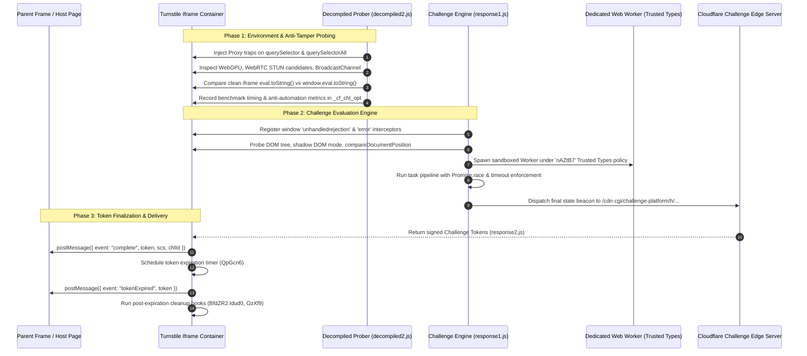
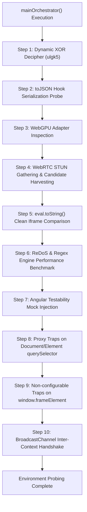

# Cloudflare Turnstile / Managed Challenge VM — Decompiled Architecture Specification

This repository contains the complete, high-fidelity reverse-engineered and decompiled JavaScript implementations of Cloudflare Turnstile's virtual machine (VM) bytecode routines.

The codebase is partitioned into three core operational stages:
1. **[`response1.js`](https://github.com/harukasen/turnstile-reverse-decoded-result/blob/main/response1.js)**: Main Challenge Evaluation Engine (1,468 instructions, 23 closures).
2. **[`response2.js`](https://github.com/harukasen/turnstile-reverse-decoded-result/blob/main/response2.js)**: Challenge Completion, Token Packaging & Cross-Frame Delivery (99 instructions, 3 closures).
3. **[`decompiled2.js`](https://github.com/harukasen/turnstile-reverse-decoded-result/blob/main/prerunprogram-vm-int.js)**: Deep Client Environment, Hardware & DOM Anti-Tamper Probing (735 instructions, 19 functions).

---

## 1. Executive Summary & Challenge Lifecycle Flow

Cloudflare Turnstile executes client-side validation as a multi-tier pipeline inside a custom register-based JavaScript virtual machine. The execution lifecycle proceeds sequentially across three discrete phases:



---

## 2. In-Depth Technical Specification: `response1.js`

**Challenge Session ID**: `a482088fff093c13`  

`response1.js` orchestrates environment fingerprinting, sandboxed worker isolation, dynamic task execution, and result beacon dispatch.

### 2.1 Cryptographic & String Transformation Primitives
- **`byteToHex(b)` (Closure `0x03D6`)**:
  Converts an 8-bit unsigned integer into a padded 2-character hexadecimal representation (`b.toString(16).padStart(2, "0")`).
- **`hashBufferToHex(buffer)` (Closure `0x041B`)**:
  Converts an `ArrayBuffer` or `Uint8Array` digest into a continuous hex string.
- **`decipherString(str, key)` (Closures `0x009F`, `0x00F3`, `0x019E`)**:
  Decodes length-prefixed and packed strings stored in bytecode buffers. Parses 2-byte/4-byte headers (e.g., `\0\u{2}[]`, `\0\u{1}0`) and performs modular character shift XOR arithmetic:
  $$\text{output}[i] = (\text{code}[i] \ \& \ 255) \oplus ((key + i) \ \& \ 255)$$
- **`sha256Digest(data)` (Closure `0x0488`)**:
  Computes SHA-256 digests via standard `window.crypto.subtle.digest("SHA-256", buffer)`. If SubtleCrypto is unavailable or blocked, falls back to the proprietary software digest routine `window.yMNq4(data)`.

### 2.2 DOM Isolation & Error Handling
- **`createHiddenIframe()` (Closure `0x0298`)**:
  Creates an invisible `0px x 0px` sandboxed iframe (`sandbox="allow-same-origin"`, `visibility: hidden; border: none; position: absolute; top: 0; left: 0`). Injected directly into the Turnstile element container `chlOpt.gNoox7` (or `document.body`).
- **`onUnhandledRejection(event)` (Closure `0x058C`)**:
  - Intercepts promise rejections and calls `event.preventDefault()`.
  - Extracts debug metadata via `chlOpt.PvgAG6.QUAMj1()`.
  - Appends rejection reason to `chlOpt.PvgAG6.rqvo8`.
  - Dispatches diagnostic telemetry to Cloudflare via `window.PfTN4(reason, "Opay4", chlOpt.kQOwR1)`.
- **`onWindowError(event, stateBag)` (Closure `0x073C`)**:
  - Immediately revokes active object URLs (`URL.revokeObjectURL(stateBag.MUXdN7)`) and terminates the background Web Worker (`stateBag.Xhlo9.terminate()`).
  - Filters out generic `"script error"` cross-origin notifications.
  - Sets the global health flag `window.PmusQ9 = false`.
  - Collects stack telemetry into `{ GekQc8: event.message, zuEb9: event.filename, JxYV7: event.lineno, CIIio0: event.colno, wCgii9: event.error }`.
  - Dispatches incident beacon via `window.PfTN4(payload, "aZhEf7", chlOpt.kQOwR1)`.
  - Attaches `error.QYNe4 = true` and re-throws the exception.

### 2.3 Challenge Task Pipeline
The challenge task queue (`taskQueue`) executes dynamic probe tasks in parallel with strict per-task timeout enforcement:

| Closure | Routine | Purpose / Operational Behavior |
| :--- | :--- | :--- |
| `0xDE95` | `wrapResult(task, val)` | Encapsulates task output into `{ svEtd6: task.svEtd6, eOgrn0: val }`. |
| `0xDECB` | `wrapSuccessFlag(task)` | Emits success indicator `{ svEtd6: task.svEtd6, bQjGu7: true }`. |
| `0xDF05` | `onTaskTimeout(task, res)` | Executes timeout callback `task.veJRU5.call()`. On error, triggers cipher fallback `window.SkQox7(CIPHER_PAYLOAD_5)`. Resolves `{ svEtd6, ChRE0: true, eOgrn0: undefined }`. |
| `0xE01C` | `scheduleTaskTimeout(...)` | Wrapper for `window.setTimeout(onTaskTimeout, timeoutMs)`. |
| `0xE05F` | `clearTaskTimeout(...)` | Wrapper for `window.clearTimeout(timerId)`. |
| `0xE08A` | `executeChallengeTask(task)` | Computes timeout bound from `task.dndff2` or `Math.max(0, 2000 - (Date.now() - task.cmqLa9))`. Executes `Promise.race([taskPromise, timeoutPromise])`. |
| `0xE1EB` | `mirrorProperty(tgt, src, p)` | Copies property descriptor using `Object.getOwnPropertyDescriptor` and `Object.defineProperty`. |
| `0xE25A` | `onAllTasksResolved(res)` | Aggregates results: sets `target.telu1 = true` on success, mirrors returned objects, sets `target.qqin0 = true` on timeout, and decrypts verification tokens (`CIPHER_PAYLOAD_1` through `CIPHER_PAYLOAD_4`). |
| `0xE68D` | `onTasksError(err)` | Handles rejection in the task batch by invoking fallback `window.SkQox7(CIPHER_PAYLOAD_2)`. |
| `0xE710` | `onTasksFinally(...)` | Records total duration `stateBag.VPlfa6 = Date.now() - startTime`, drains `taskQueue.length = 0`, and executes beacon transmission. |

### 2.4 Beacon Construction & Finalization (`0xD840`)
1. **Worker Disposal**: Calls `URL.revokeObjectURL` on `stateBag.MUXdN7` and `.terminate()` on `stateBag.Xhlo9`.
2. **State Cleanup**: Resets `stateBag.QtLXm2 = ""`.
3. **Endpoint Construction**:
   $$\text{URL} = \text{BEACON\_BASE} + \text{"/h/"} + (\text{chlOpt.DuPd9} \ || \ \text{""}) + \text{BEACON\_PATH}$$
   Where `BEACON_BASE` is `"/cdn-cgi/challenge-platform"` and `BEACON_PATH` contains the challenge session ID (`385944947:1791594335:.../a482088fff093c13/...`).
4. **Transport Strategy**: Transmits payload via `window.SkQox7` if available, falling back to `window.fetch` (`POST, application/json`) or `navigator.sendBeacon`.

### 2.5 State Dictionary & DOM Inspection (`0x6535E` & `0x35A22`)
The runtime state bag (`stateBag`) records over 40 distinct browser and configuration parameters:

| State Key | Source Expression / Origin | Description |
| :--- | :--- | :--- |
| `hYPXy0` | `chlOpt.aUlu1` | Internal challenge mode token |
| `KimyV3` | `chlOpt.KimyV3` | Primary challenge session identifier |
| `XamU2` | `chlOpt.XamU2` | Widget rendering configuration |
| `CRAW0` | `"oWrxl6"` | Static VM handler signature |
| `NKjo6` | `chlOpt.oCmIf9 - chlOpt.NbNuk0` | Server-to-client timestamp synchronization delta |
| `DofrX3` | `chlOpt.TGLE6 - chlOpt.HglSP8` | Execution latency delta 1 |
| `eOkZH7` | `chlOpt.TGLE6 - chlOpt.HglSP8` | Execution latency delta 2 |
| `iDbd1` – `apSMs6` | `chlOpt[prop]` | Core feature flags (`CsJSj9`, `vhKyy7`, `AccaH6`, `pcFOG3`, `JJcr4`, etc.) |
| `uEkj3` | `chlOpt.PgGRd4 - chlOpt.ydrIB0` | Internal script parsing delay delta |
| `KweJ1` | `window.iaNL2()` | Dynamic runtime checksum |
| `bQWwB7` | `body.shadowRoot && mode === "closed"` | Verification that Turnstile container shadow DOM is closed |
| `vvZW7` / `hzxxI7` | `compareDocumentPosition` flag | Node hierarchy verification between `head`, `body`, and container elements |
| `UFlzi7` | `JSON.stringify(domMetrics)` | 8-element array recording shadow DOM mode, HTML length, and attachShadow stringification |
| `MUXdN7` | `URL.createObjectURL(blob)` | Blob URL for Trusted Types Web Worker |
| `Xhlo9` | `new Worker(workerUrl)` | Dedicated background worker instance |
| `ikWJl0` | `sha256Digest` | Worker cryptographic message digest routine |
| `bLwNX7` | `JSON.parse("[]")` | Deserialized task list |
| `bLVb2` / `Pqyt7` | Decrypted ciphertext buffers | Dynamic challenge runtime configurations |
| `QgLe6` | `JSON.parse("0")` | Task queue index pointer |
| `jIdZ4` | Decrypted ciphertext buffer | Encrypted instruction block |
| `VPlfa6` | `Date.now() - startTime` | Execution runtime total (milliseconds) |

---

## 3. In-Depth Technical Specification: `response2.js`

**File**: [`response2.js`] 
(99 instructions)  
**Challenge Session ID**: `a482088fff093c13`  

`response2.js` handles the completion of the challenge, transmitting the cryptographic Turnstile verification clearance token to the host embedding page and managing token expiration lifecycles.

### 3.1 Verification Tokens & Signatures
- **`TOKEN`**: 684-character cryptographic signed challenge clearance token (`1.SXMVe1i9fbYjCIodxGYMem...9fac66e51c68fb67ae6e914b2603dc540d8d216897a91bb2fce791c4a1af3a7e`).
- **`SCS`**: Secondary challenge signature (`scs.1.uVjgn4ogBs8ncZAO7ZTS...`).
- **`CHL_ID`**: Target challenge session ID (`a482088fff093c13`).

### 3.2 Functions & Lifecycle Closures

#### 1. `onExpirationCleanup()` (Closure `0x00C7`)
Invoked 1,000ms after the token expires. Triggers internal challenge teardown:
```javascript
function onExpirationCleanup() {
    if (BfdZR2) {
        if (typeof BfdZR2["Idud0"] === "function") BfdZR2["Idud0"]();
        if (typeof BfdZR2["OzXf9"] === "function") BfdZR2["OzXf9"]();
    }
}
```

#### 2. `onChallengeComplete()` (Closure `0x04CC`)
The master completion handler:
- Tracks expiration state via local closure flag `tokenExpiredDispatched = false`.
- Sets global completion flags:
  ```javascript
  window["heZSi1"] = true;
  window["HKLPs9"] = true;
  ```
- Signals internal controllers:
  ```javascript
  BfdZR2["pGgJK8"]();
  BfdZR2["RZEd5"]();
  ```
- Dispatches the `complete` event to the parent window via `window.parent.postMessage`:
  ```javascript
  parent.postMessage({
      source: "cloudflare-challenge",
      widgetId: chlOpt["tSMA8"],
      event: "complete",
      token: TOKEN,
      scs: SCS,
      chlId: CHL_ID
  }, "*");
  ```
- Schedules token expiration using the delay specified in `chlOpt["QpGcn6"]`.

#### 3. `onTokenExpired()` (Closure `0x0102`)
Fires when the verification token reaches its lifetime limit:
- Prevents duplicate dispatches via `tokenExpiredDispatched` guard.
- Posts `tokenExpired` event to the parent window:
  ```javascript
  parent.postMessage({
      source: "cloudflare-challenge",
      widgetId: chlOpt["tSMA8"],
      event: "tokenExpired",
      token: TOKEN
  }, "*");
  ```
- Schedules `onExpirationCleanup` after a 1-second grace window (`window.setTimeout(onExpirationCleanup, 1000)`).

#### 4. Auto-Execution Hook
Registers the entry point on the global object and triggers immediately if readiness flags are pre-set:
```javascript
window["fHkz0"] = onChallengeComplete;
if (window["heZSi1"]) {
    window["fHkz0"]();
}
```

---

## 4. In-Depth Technical Specification: `decompiled2.js`

**File**: [`decompiled2.js`]
**Bytecode Source**: (735 instructions across 19 functions)  
**Target Capabilities**: WebRTC, WebGPU, BroadcastChannel, Proxy DOM Traps, ReDoS Timing  

`decompiled2.js` is the deep environment and bot-detection prober executed prior to or alongside the challenge engine to detect headless browsers, automation frameworks (Puppeteer, Playwright, Selenium), and monkey-patched APIs.

### 4.1 Anti-Tamper & Environment Probing Architecture



### 4.2 Probing Modules & Detection Mechanisms

#### Step 1: Dynamic XOR Decipher Routine Injection (`0x0A67 - 0x0B65`)
Dynamically constructs an XOR deciphering function via `eval`:
```javascript
function ulgk5(s) {
    return function(k) {
        for (var o = new Uint8Array(k.length), i = 0; i < k.length; i++)
            o[i] = k[i] ^ s.charCodeAt(i % s.length);
        return o;
    };
}
```
Instantiated with static key `"gMSbwOXgRQvbSbxg"` into `_cf_chl_opt["ULcl2"]`.

#### Step 2: Custom `toJSON` Serialization Hook (`0x009B`, `0x0B69`)
Injects an object with a custom `.toJSON()` method returning `"dKWN3"` into `_cf_chl_opt.yaqE6`. When JSON serialization occurs, this reveals whether standard serialization semantics have been altered.

#### Step 3: WebGPU Hardware Fingerprinting (`0x0BBB - 0x0CC3`)
Inspects `navigator.gpu`:
- Calls `navigator.gpu.requestAdapter()`.
- Captures adapter features and hardware vendor info to detect software rendering or headless instances.
- Errors are redirected to `_cf_chl_opt["SypY9"]`.

#### Step 4: WebRTC STUN Discovery & Candidate Harvesting (`0x00CF - 0x032B`, `0x0CC3`)
Creates an `RTCPeerConnection` with 3 STUN servers:
- `stun:stun.cloudflare.com:3478`
- `stun:stun.l.google.com:19302`
- `stun:stun1.l.google.com:19302`
- Tests DataChannel creation (`pc.createDataChannel("")`).
- Records all ICE candidate strings (`FiSsH3`) and discovery latency (`MfDC4 = Date.now() - startTime`) into `state["JzxX6"]`.
- Generates an SDP offer with audio/video receive flags.
- Closes the connection automatically after 5,000ms.

#### Step 5: Native `eval.toString()` Integrity Comparison (`0x032D`, `0x1050`)
Detects monkey-patching and hook frameworks:
1. Captures `window.eval.toString()`.
2. Creates a clean, sandboxed iframe (`createHiddenIframe()`).
3. Extracts `iframe.contentWindow.eval.toString()`.
4. Compares:
   ```javascript
   const isEvalTampered = (nativeEvalToString !== cleanEvalToString);
   chlOpt["eval_tampered"] = isEvalTampered;
   ```
5. Removes the test iframe immediately.

#### Step 6: Regex Timing & ReDoS Benchmark (`0x045A`, `0x1110`)
Measures JavaScript engine execution timing and regex backtracking behavior:
- Generates a pathological string payload:
  ```javascript
  const testPayload = " ".repeat(1337331) + "0, /.*honk.*/, ";
  ```
- Evaluates engine execution time and writes elapsed milliseconds into `_cf_chl_opt["atsr5"]`.

#### Step 7: Angular Testability Mock Injection (`0x05AB - 0x05E0`, `0x11EF`)
Mocks the Angular test framework hook `window._cf_chl_opt.angular = { getTestability: ... }`. Detects whether external testing scripts attempt to synchronize with or poll testability hooks.

#### Step 8: DOM Query Proxy Traps (`0x05E2 - 0x0683`, `0x12B2`)
Detects automated scraping bots and query activity:
- Replaces native methods on `Document.prototype` and `Element.prototype` (`querySelector`, `querySelectorAll`) with a `Proxy`.
- Any CSS selector queried by host scripts or scraper bots is captured into `_cf_chl_opt["GOxN9"]`:
  ```javascript
  function proxyApplyTrap(target, thisArg, argArray) {
      if (argArray && argArray.length > 0) {
          chlOpt["GOxN9"].push(String(argArray[0]));
      }
      return Reflect.apply(target, thisArg, argArray);
  }
  ```
- Backs up original function pointers in `_cf_chl_opt["PREJ9"]`.

#### Step 9: Window Property Getter Traps (`0x0685 - 0x077D`, `0x1447`)
Configures non-configurable, non-enumerable traps on `window.frameElement`:
- Accessing `frameElement` pushes `"frameElement"` into `_cf_chl_opt["GOxN9"]`.
- If `Object.defineProperty` fails (e.g. if pre-hooked by an extension or headless wrapper), sets `_cf_chl_opt["dxLyU0"] = "GQpe9"`.

#### Step 10: BroadcastChannel Inter-Context Handshake (`0x077F - 0x083C`, `0x1595`)
Verifies execution within a full browser context supporting cross-tab communication:
- Opens `new BroadcastChannel("a")`.
- Transmits `{ ping: token }` and handles bidirectional pong messages, incrementing handshake counter `_cf_chl_opt["qYSky6"]`.

---

## 5. Cross-Script Synergy & Shared State Reference Matrix

The table below documents how runtime data flows between `decompiled2.js`, `response1.js`, and `response2.js` through `window._cf_chl_opt`:

| Property Key | Writer Script | Reader Script | Functional Role |
| :--- | :--- | :--- | :--- |
| `KimyV3` | Host / Server Injection | `decompiled2.js`, `response1.js` | Challenge session token for BroadcastChannel & beacon identification |
| `gNoox7` | Host Widget Host | `response1.js`, `decompiled2.js` | Turnstile container DOM element |
| `GOxN9` | `decompiled2.js` (Proxy) | `response1.js` | Log of scraper CSS queries and `frameElement` inspections |
| `dxLyU0` | `decompiled2.js` (Traps) | `response1.js` | Property hook integrity status flag |
| `atsr5` | `decompiled2.js` (Benchmark)| `response1.js` | Regex engine execution time benchmark |
| `igenI1` | `decompiled2.js` (WebGPU) | `response1.js` | WebGPU adapter hardware inspection object |
| `dSkYd9` | `decompiled2.js` (WebRTC) | `response1.js` | WebRTC peer connection state & harvested ICE candidates |
| `qYSky6` | `decompiled2.js` (BC) | `response1.js` | BroadcastChannel roundtrip message counter |
| `PmusQ9` | `response1.js` (Init/Error) | Host Environment | Script health status indicator (`true` = healthy, `false` = error) |
| `MUXdN7` | `response1.js` (Worker) | `response1.js` (Finalizer) | Trusted Types Web Worker blob URL (revoked upon completion) |
| `Xhlo9` | `response1.js` (Worker) | `response1.js` (Finalizer) | Web Worker instance thread (terminated upon completion) |
| `UFlzi7` | `response1.js` (Fingerprint) | Edge Beacon Server | Serialized 8-element DOM structure metrics payload |
| `VPlfa6` | `response1.js` (Finally) | Edge Beacon Server | Total challenge pipeline runtime in milliseconds |
| `tSMA8` | Host Widget Host | `response2.js` | Turnstile widget instance identifier for `postMessage` |
| `heZSi1` | `response2.js` (Completion) | Host / Turnstile Runtime | Challenge complete readiness indicator |
| `HKLPs9` | `response2.js` (Completion) | Host / Turnstile Runtime | Challenge validation success indicator |
| `QpGcn6` | Server Injection | `response2.js` | Verification token validity duration in milliseconds |

---

