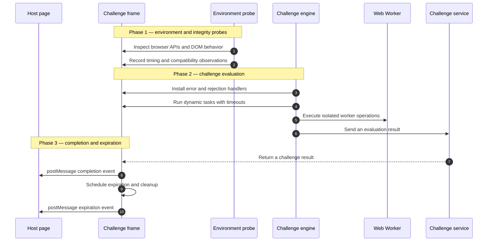
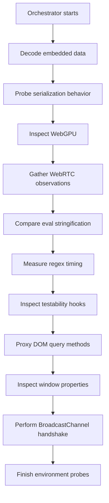

# Cloudflare Challenge VM — Decompiled Architecture Notes

> **Research notice:** This repository contains analysis of client-side JavaScript observed during authorized research. It is not affiliated with, endorsed by, or sponsored by Cloudflare. Do not use these materials to bypass access controls, evade bot protections, collect user data, or interfere with services. Remove or redact any session IDs, tokens, URLs, and environment-specific values before publishing.

## Overview

This repository documents a reverse-engineering/decompilation effort involving three related JavaScript components:

1. [**`response1.js`**](https://github.com/harukasen/turnstile-reverse-decoded-result/blob/main/response1.js) — Challenge evaluation and task orchestration.

1. [**`response2.js`**](https://github.com/harukasen/turnstile-reverse-decoded-result/blob/main/response2.js) — Completion handling, token lifecycle, and cross-frame messaging.

1. [**`prerunprogram-vm-int.js`**](https://github.com/harukasen/turnstile-reverse-decoded-result/blob/main/prerunprogram-vm-int.js) — Environment, hardware, DOM, and anti-tamper probes. The source is referred to as `decompiled2.js` in some notes.

The instruction and closure counts below are observations from the analyzed artifacts and may change between deployments. They should not be treated as stable Cloudflare implementation details.

## Contents

- [Architecture](#architecture)

- [`response1.js`](#response1js)
  - [Transformation and digest helpers](#transformation-and-digest-helpers)
  - [DOM isolation and error handling](#dom-isolation-and-error-handling)
  - [Task pipeline](#task-pipeline)
  - [Beacon finalization](#beacon-finalization)
  - [Runtime state](#runtime-state)

- [`response2.js`](#response2js)

- [`prerunprogram-vm-int.js`](#prerunprogram-vm-intjs)

- [Shared state](#shared-state)

- [Limitations](#limitations)

- [Responsible disclosure](#responsible-disclosure)

## Architecture

The analyzed code appears to implement a three-phase client-side pipeline:



## `response1.js`

`response1.js` appears to coordinate environment fingerprinting, worker isolation, dynamic task execution, timeout handling, and result transmission.

### Transformation and digest helpers

- **`byteToHex`** — Converts an 8-bit value to a two-character hexadecimal string.

- **`hashBufferToHex`** — Converts an `ArrayBuffer` or `Uint8Array` digest to a hexadecimal string.

- **`decipherString`** — Decodes length-prefixed or packed strings embedded in bytecode buffers. The observed transformation includes modular character shifts and XOR operations.

- **`sha256Digest`** — Uses `crypto.subtle.digest("SHA-256", ...)` when available and appears to fall back to an internal digest routine otherwise.

> Do not publish captured ciphertext, session-specific keys, signed tokens, or live challenge payloads. They are deployment-specific and may be security-sensitive.

### DOM isolation and error handling

- **Hidden iframe creation** — Creates a zero-sized, hidden iframe with a restricted sandbox configuration for isolated checks.

- **Unhandled-rejection handling** — Intercepts promise rejections, records diagnostic data, and forwards telemetry through an internal reporting function.

- **Window-error handling** — Releases worker resources and object URLs, records error metadata, updates a health flag, and reports the incident.

The exact names of internal properties and reporting functions are deployment-specific obfuscation artifacts and should not be assumed to be stable APIs.

### Task pipeline

The observed task queue runs dynamic probe tasks with per-task timeout enforcement:

| Closure | Routine | Observed behavior |
| --- | --- | --- |
| `0xDE95` | `wrapResult(task, value)` | Associates a task identifier with its result. |
| `0xDECB` | `wrapSuccessFlag(task)` | Emits a task success indicator. |
| `0xDF05` | `onTaskTimeout(task, result)` | Invokes timeout handling and returns a timeout result. |
| `0xE01C` | `scheduleTaskTimeout(...)` | Wraps `setTimeout`. |
| `0xE05F` | `clearTaskTimeout(...)` | Wraps `clearTimeout`. |
| `0xE08A` | `executeChallengeTask(task)` | Races task execution against a timeout promise. |
| `0xE1EB` | `mirrorProperty(target, source, property)` | Copies a property descriptor. |
| `0xE25A` | `onAllTasksResolved(result)` | Aggregates task results and updates shared state. |
| `0xE68D` | `onTasksError(error)` | Handles batch-level task failure. |
| `0xE710` | `onTasksFinally(...)` | Records duration, clears the queue, and initiates finalization. |

### Beacon finalization

The finalization path appears to:

1. Revoke a worker object URL and terminate the worker.

1. Clear transient state.

1. Construct a challenge-platform endpoint from runtime configuration.

1. Send a result using an internal transport helper, `fetch`, or `navigator.sendBeacon`, depending on availability.

The endpoint, path, payload, and session identifiers vary by deployment. Keep them out of public documentation unless they are already public and non-sensitive.

### Runtime state

The runtime state bag contains browser observations, feature flags, timing values, worker references, and task data. Representative fields include:

| Field | Observed source | Purpose |
| --- | --- | --- |
| `hYPXy0` | Challenge configuration | Internal mode value. |
| `KimyV3` | Challenge configuration | Session-related identifier. |
| `XamU2` | Challenge configuration | Widget configuration. |
| `NKjo6` | Timestamp difference | Clock synchronization delta. |
| `DofrX3`, `eOkZH7` | Timestamp differences | Execution-latency measurements. |
| `KweJ1` | Runtime helper | Dynamic runtime checksum or probe result. |
| `bQWwB7` | Shadow DOM inspection | Closed-shadow-root observation. |
| `vvZW7`, `hzxxI7` | `compareDocumentPosition` | DOM hierarchy observations. |
| `UFlzi7` | Serialized DOM metrics | DOM structure and rendering observations. |
| `MUXdN7` | `URL.createObjectURL` | Worker blob URL. |
| `Xhlo9` | `new Worker(...)` | Worker instance. |
| `VPlfa6` | Elapsed time | Total pipeline duration in milliseconds. |

## `response2.js`

`response2.js` appears to manage challenge completion, parent-frame messaging, token expiration, and cleanup.

### Completion lifecycle

The observed lifecycle is:

1. Mark completion state in the local runtime.

1. Notify internal controllers.

1. Send a completion message to the parent frame.

1. Schedule expiration using a runtime-provided delay.

1. Send a single expiration message when the lifetime ends.

1. Run cleanup callbacks after a short grace period.

A representative, redacted message shape is:

```javascript
window.parent.postMessage(
  {
    source: "cloudflare-challenge",
    widgetId: "<redacted-widget-id>",
    event: "complete",
    token: "<redacted-token>",
    scs: "<redacted-signature>",
    chlId: "<redacted-challenge-id>"
  },
  "*"
);
```

The expiration message omits completion-only fields and uses `event: "tokenExpired"`.

### Cleanup

The expiration cleanup routine invokes available teardown callbacks after a one-second grace period. The exact callback names are obfuscated and can change between builds.

## `prerunprogram-vm-int.js`

The file referred to as `decompiled2.js` in the original notes appears to perform browser-environment and anti-tamper probes. The following list describes observed behavior, not a guarantee of current production behavior.



### Observed probe categories

1. **Dynamic decoding** — Builds an XOR-based decoder and stores it in challenge configuration.

1. **Serialization behavior** — Adds an object with a custom `toJSON()` method to observe serialization semantics.

1. **WebGPU inspection** — Requests an adapter and records supported features or errors when the API is available.

1. **WebRTC inspection** — Creates a peer connection, creates a data channel, gathers ICE candidates, records timing, and closes the connection after a timeout.

1. **`eval.toString()`**** comparison** — Compares the host implementation with one obtained from an isolated iframe.

1. **Regex timing** — Measures execution time for a large regular-expression workload. This should not be reproduced against production systems without explicit authorization.

1. **Testability-hook observation** — Installs or inspects a testability-related hook.

1. **DOM query proxies** — Wraps `querySelector` and `querySelectorAll` to observe selector usage and preserve the original functions.

1. **Window-property traps** — Attempts to define a getter or trap around `window.frameElement` and records failures.

1. **BroadcastChannel handshake** — Opens a channel, exchanges a short message, and records the observed round trip.

## Shared state

The analyzed scripts appear to exchange data through a shared challenge configuration object, commonly represented as `window._cf_chl_opt` in the decompiled output.

| Property | Writer | Reader | Observed role |
| --- | --- | --- | --- |
| `KimyV3` | Host/runtime | Probe, engine | Session-related value. |
| `gNoox7` | Host/widget | Probe, engine | Widget container reference. |
| `GOxN9` | Probe | Engine | Observed selector/property accesses. |
| `dxLyU0` | Probe | Engine | Hook-integrity status. |
| `atsr5` | Probe | Engine | Regex timing observation. |
| `igenI1` | Probe | Engine | WebGPU result. |
| `dSkYd9` | Probe | Engine | WebRTC result. |
| `qYSky6` | Probe | Engine | BroadcastChannel counter. |
| `PmusQ9` | Engine | Runtime | Script health indicator. |
| `MUXdN7` | Engine | Finalizer | Worker object URL. |
| `Xhlo9` | Engine | Finalizer | Worker instance. |
| `UFlzi7` | Engine | Edge service | Serialized DOM metrics. |
| `VPlfa6` | Engine | Edge service | Total execution time. |
| `tSMA8` | Host/widget | Completion handler | Widget identifier. |
| `heZSi1` | Completion handler | Runtime | Completion state. |
| `HKLPs9` | Completion handler | Runtime | Validation state. |
| `QpGcn6` | Runtime | Completion handler | Token lifetime. |

## Limitations

- Obfuscated property names, closure offsets, instruction counts, endpoints, and payload formats are build-specific.

- Decompilation can misrepresent control flow, inferred names, or asynchronous behavior.

- Browser APIs differ across engines, versions, privacy settings, and extensions.

- The notes do not establish that every observed behavior is present in current production deployments.

- Never commit live tokens, cookies, private keys, session identifiers, or personal data. Use placeholders such as `<redacted-token>`.

## Responsible disclosure

If analysis reveals a security vulnerability or an unintended privacy issue, stop testing, preserve only the minimum evidence necessary, and report it through the vendor's official security-reporting channel. Do not publish exploit instructions or sensitive artifacts before coordinated disclosure.

## License and provenance

Add the project's actual license and provenance information here. If the code was generated from third-party artifacts, document the source, permissions, and applicable redistribution terms before publishing.
